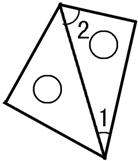

# Mathematics (Grade 4)

**ID**: 090753b3
**难度**: medium_hard
**题型**: fill_in_the_blank

## 题目
用一副三角尺可以拼成如右下产所示的四边形．拼成的四边形中∠1=$\underline{\hspace{5em}}$°，∠2=$\underline{\hspace{5em}}$°．

## 解答

**答案**: 30, 60

1. Step1:明确一副三角尺的角度有30°、45°、60°、90°
2. Step2:观察拼成的四边形，得出∠1是三角尺中的30°角
3. Step3:观察拼成的四边形，得出∠2是三角尺中的60°角

## 知识点

**知识点**:
  - 三角形的内角和．

---
