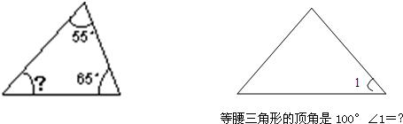

# Mathematics (Grade 4)

**ID**: 09d83ddd
**难度**: medium_hard
**题型**: fill_in_the_blank

## 题目
求出下面各角的度数

## 解答

**答案**: 60, 40

1. Step1:对于第一个三角形，已知三角形内角和为180度，用180减去已知的两个角55度和65度，即180 - 55 - 65 = 60度，得到第三个角的度数为60度
2. Step2:对于等腰三角形，因为等腰三角形两底角相等，三角形内角和为180度，先计算180 - 100 = 80度，再将80度除以2，即80÷2 = 40度，得到∠1的度数为40度

## 知识点

**知识点**:
  - 三角形的内角和

---
