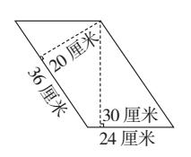

# Mathematics (Grade 4)

**ID**: 09eca97f
**难度**: medium_hard
**题型**: fill_in_the_blank

## 题目
写出下面平行四边形中相对应的底和高，计算出平行四边形的周长

底（）厘米，高（）厘米；
底（）厘米，高（）厘米；
平行四边形的周长是（）厘米。

## 解答

**答案**: 36, 20, 24, 30, 120

1. Step1:根据平行四边形高的定义，从图中可知与高20厘米垂直的底是36厘米
2. Step2:从图中可知与高30厘米垂直的底是24厘米
3. Step3:根据平行四边形对边平行且相等，可知平行四边形相邻两边分别为24厘米和36厘米
4. Step4:根据平行四边形周长等于相邻两条边的和乘2，计算(24 + 36)×2 = 120厘米得到周长

## 知识点

**知识点**:
  - 平行四边形的特征

---
