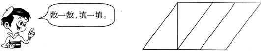

# Mathematics (Grade 4)

**ID**: 0aae554f
**难度**: medium_hard
**题型**: fill_in_the_blank

## 题目
如图中有$\underline{\hspace{5em}}$个三角形，$\underline{\hspace{5em}}$个平行四边形，$\underline{\hspace{5em}}$个梯形．

## 解答

**答案**: 2, 6, 2

1. Step1:观察图形，数出三角形的个数为2个
2. Step2:数平行四边形的个数，单个的平行四边形有3个，2个平行四边形组成的有2个，三个平行四边形组成的有1个，所以平行四边形总数为3 + 2 + 1 = 6个
3. Step3:数梯形的个数，一个三角形与一个平行四边形组成的梯形有1个，一个三角形与2个平行四边形组成的梯形有1个，所以梯形总数为1 + 1 = 2个

## 知识点

**知识点**:
  - 组合图形的计数．

---
