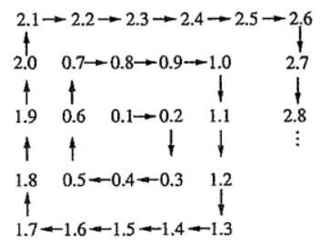

# Mathematics (Grade 4)

**ID**: 197ad6a5
**难度**: medium_hard
**题型**: fill_in_the_blank

## 题目
如图，小数按从小到大的顺序排成螺旋形，在0.2处拐第一个弯，在0.3处拐第二个弯，在0.5处拐第三个弯.......则拐第二十个弯的地方的数是_______.

## 解答

**答案**: 11.1

1. Step1:观察发现偶数弯上的数存在规律，第0个弯是0.1
2. Step2:第2个弯的数0.3 = 0.1 + 0.2
3. Step3:第4个弯的数0.7 = 0.1 + 0.2 + 0.4
4. Step4:第6个弯的数1.3 = 0.1 + 0.2 + 0.4 + 0.6
5. Step5:总结出偶数弯上数的规律为第n个偶数弯（n从0开始）上的数是0.1加上从0.2开始依次增加0.2的数，加到0.2×(n/2)
6. Step6:第20个弯是偶数弯，此时n = 20
7. Step7:根据规律，第20个弯上的数是0.1 + 0.2 + 0.4 + 0.6 + ⋯ + 2
8. Step8:0.2 + 0.4 + 0.6 + ⋯ + 2是一个首项为0.2，末项为2，公差为0.2，项数为10的等差数列
9. Step9:根据等差数列求和公式S = (首项 + 末项)×项数÷2，可得0.2 + 0.4 + 0.6 + ⋯ + 2 = (2 + 0.2)×10÷2
10. Step10:计算第20个弯上的数为0.1 + (2 + 0.2)×10÷2 = 11.1

## 知识点

**知识点**:
  - 小数的加法和减法;整数运算定律推广到小数

---
