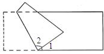

# Mathematics (Grade 4)

**ID**: 2439def1
**难度**: medium_hard
**题型**: fill_in_the_blank

## 题目
把一张长方形纸如图折起来，∠2=65°，∠1=______°．

## 解答

**答案**: 50

1. Step1:根据解析2可知，展开长方形纸后，以∠1、∠2的顶点为顶点的角是180°，且∠1 + 2∠2 = 180°
2. Step2:已知∠2 = 65°，将其代入∠1 + 2∠2 = 180°，得到∠1 + 2×65° = 180°
3. Step3:计算2×65° = 130°，则∠1 + 130° = 180°
4. Step4:由∠1 + 130° = 180°，可得∠1 = 180° - 130°
5. Step5:计算180° - 130° = 50°，所以∠1 = 50°

## 知识点

**知识点**:
  - 简单图形的折叠问题;角的度量．

---
