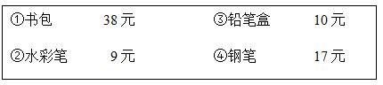

# Mathematics (Grade 4)

**ID**: 27a85d04
**难度**: medium_hard
**题型**: fill_in_the_blank

## 题目
小朋友们去买学习用品，价格如下：

（1）买一个书包和一个铅笔盒要多少元？
算式：
（2）小亚买了一支钢笔，给营业员20元，应找回多少钱？
算式： 
（3） 如果你有50元钱，可以买哪两样文具？（填一填）
我会选 $\underline{\hspace{5em}}$ 和 $\underline{\hspace{5em}}$ （写序号）
算式：

## 解答

**答案**: 48, 3, ①, ③

1. Step1:计算买一个书包和一个铅笔盒的总价钱，书包价格38元，铅笔盒价格10元，算式为38 + 10 = 48元，所以第一个空答案是48
2. Step2:计算小亚买一支钢笔给营业员20元应找回的钱数，钢笔价格17元，算式为20 - 17 = 3元，所以第二个空答案是3
3. Step3:考虑50元能买哪两样文具，计算①书包和②水彩笔的价格和为38 + 9 = 47元，47元小于50元，符合要求，所以第三、四个空答案为①和③

## 知识点

**知识点**:
  - 小学数学;数与代数;数的运算;整数的四则运算

---
