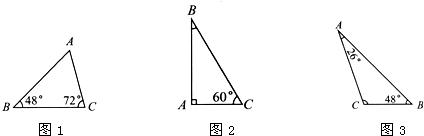

# Mathematics (Grade 4)

**ID**: 2b2d16c9
**难度**: medium_hard
**题型**: fill_in_the_blank

## 题目
求如图所示各角的度数．

图1中∠A=$\underline{\hspace{5em}}$
图2中∠B=$\underline{\hspace{5em}}$
图3中∠C=$\underline{\hspace{5em}}$．

## 解答

**答案**: 60°, 30°, 106°

1. Step1:根据三角形内角和为180°，计算图1中∠A的度数，用180°减去∠B与∠C的度数和，即180°-(48° + 72°)=60°
2. Step2:计算图2中∠B的度数，方法一：因为三角形内角和为180°且有一个直角90°，所以用90°减去∠C的度数60°，可得∠B为90° - 60° = 30°；方法二：用180°减去直角90°与∠C的度数60°的和，即180°-(90° + 60°)=30°
3. Step3:计算图3中∠C的度数，根据三角形内角和为180°，用180°减去∠A与∠B的度数和，即180°-(26° + 48°)=106°

## 知识点

**知识点**:
  - 角的度量．

---
