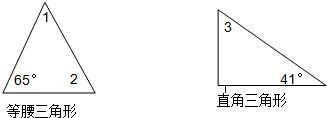

# Mathematics (Grade 4)

**ID**: 2c7579b5
**难度**: medium_hard
**题型**: fill_in_the_blank

## 题目
计算三角形中角的度数． 
∠1=$\underline{\hspace{5em}}$，∠2=$\underline{\hspace{5em}}$，∠3=$\underline{\hspace{5em}}$．

## 解答

**答案**: 50°, 65°, 49°

1. Step1:因为该三角形是等腰三角形，等腰三角形两底角相等，所以∠2 = 65°
2. Step2:根据三角形内角和为180°，可得∠1 = 180° - 65° - 65° = 50°
3. Step3:因为该三角形是直角三角形，直角三角形两锐角和为90°，所以∠3 = 90° - 41° = 49°

## 知识点

**知识点**:
  - 角的度量；三角形的内角和．

---
