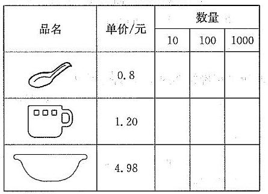

# Mathematics (Grade 4)

**ID**: 2da9d6ed
**难度**: medium_hard
**题型**: fill_in_the_blank

## 题目
在下表中填出每种商品的总价。      

## 解答

**答案**: 8, 80, 800, 12, 120, 1200, 49.8, 498, 4980

1. Step1:计算单价为0.8元的商品数量为10时的总价，0.8×10=8
2. Step2:计算单价为0.8元的商品数量为100时的总价，0.8×100=80
3. Step3:计算单价为0.8元的商品数量为1000时的总价，0.8×1000=800
4. Step4:计算单价为1.20元的商品数量为10时的总价，1.20×10=12
5. Step5:计算单价为1.20元的商品数量为100时的总价，1.20×100=120
6. Step6:计算单价为1.20元的商品数量为1000时的总价，1.20×1000=1200
7. Step7:计算单价为4.98元的商品数量为10时的总价，4.98×10=49.8
8. Step8:计算单价为4.98元的商品数量为100时的总价，4.98×100=498
9. Step9:计算单价为4.98元的商品数量为1000时的总价，4.98×1000=4980

## 知识点

**知识点**:
  - 小数的意义和性质;小数点移动引起小数大小的变化（1）

---
