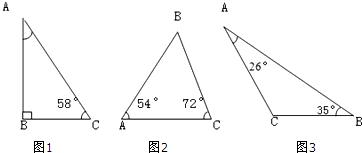

# Mathematics (Grade 4)

**ID**: 377dad6c
**难度**: medium_hard
**题型**: fill_in_the_blank

## 题目
求下面各角的度数．

∠A=$\underline{\hspace{5em}}$；∠B=$\underline{\hspace{5em}}$；∠C=$\underline{\hspace{5em}}$．

## 解答

**答案**: 32°, 54°, 119°

1. Step1:根据三角形内角和为180°，计算图1中∠A的度数，∠A=180°-(58° + 90°)=180° - 148°=32°
2. Step2:根据三角形内角和为180°，计算图2中∠B的度数，∠B=180°-(54° + 72°)=180° - 126°=54°
3. Step3:根据三角形内角和为180°，计算图3中∠C的度数，∠C=180°-(26° + 35°)=180° - 61°=119°

## 知识点

**知识点**:
  - 三角形的内角和．

---
