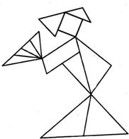

# Mathematics (Grade 4)

**ID**: 46d235b4
**难度**: medium_hard
**题型**: fill_in_the_blank

## 题目
在如图中数一数．
（1）有$\underline{\hspace{5em}}$个平行四边形．
（2）有$\underline{\hspace{5em}}$个三角形．

## 解答

**答案**: 2, 17

1. Step1:根据平行四边形的定义，正方形是特殊的平行四边形，观察图形可知有2个平行四边形
2. Step2:分别数出不同位置三角形的个数，最上面有2个三角形
3. Step3:数出最左边三角形的个数为10个
4. Step4:数出中间三角形的个数为2个
5. Step5:数出最下面三角形的个数为3个
6. Step6:将不同位置三角形个数相加，2+10+2+3=17个三角形

## 知识点

**知识点**:
  - 组合图形的计数．

---
