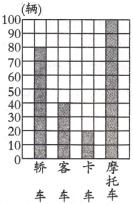

# Mathematics (Grade 4)

**ID**: 4fa76f0c
**难度**: medium_hard
**题型**: fill_in_the_blank

## 题目
王老师带着统计小组的同学，在一个路口10分钟内统计各种机动车通过的情况如图．
（1）上图一格表示$\underline{\hspace{5em}}$辆车．
（2）平均每分钟通过多少辆摩托车？多少辆轿车？

## 解答

**答案**: 10, 10, 8

1. Step1:观察统计图，从纵坐标可知一格表示10辆车
2. Step2:已知10分钟内通过摩托车100辆，计算平均每分钟通过摩托车数量，100÷10=10辆
3. Step3:已知10分钟内通过轿车80辆，计算平均每分钟通过轿车数量，80÷10=8辆

## 知识点

**知识点**:
  - 以一当五（或以上）的条形统计图；平均数的含义及求平均数的方法；从统计图表中获取信息．

---
