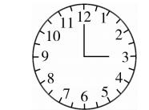

# Mathematics (Grade 4)

**ID**: 5afd099b
**难度**: medium_hard
**题型**: fill_in_the_blank

## 题目
如图，在钟面上，3时的分针和时针所夹的角是（）度。

## 解答

**答案**: 90

1. Step1:明确3时的时候，时针指向3，分针指向12
2. Step2:观察得出12到3之间是3大格
3. Step3:因为钟面上一大格是30度，所以计算3大格的度数为3×30 = 90度

## 知识点

**知识点**:
  - 角的度量;时针和分针成直角的问题

---
