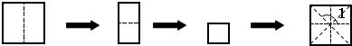

# Mathematics (Grade 4)

**ID**: 5f7af293
**难度**: medium_hard
**题型**: fill_in_the_blank

## 题目
小明把一张正方形纸先左右对折，再上下对折，最后又沿着对角线对折（如图），打开后图中∠1=$\underline{\hspace{5em}}$度．

## 解答

**答案**: 135

1. Step1:分析正方形纸的折叠过程，左右对折将正方形平均分成2份，上下对折又将每份再平均分成2份，此时共平均分成2×2 = 4份，最后沿对角线对折将每份再平均分成2份，所以总共把正方形平均分成了4×2 = 8份
2. Step2:因为周角是360°，∠1占了其中的3份，所以∠1的度数是360°×$\frac{3}{8}$
3. Step3:计算360°×$\frac{3}{8}$=135°，得出∠1的度数为135°

## 知识点

**知识点**:
  - 简单图形的折叠问题；角的度量．

---
