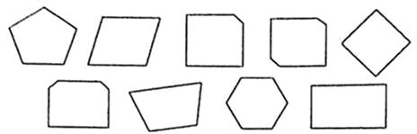

# Mathematics (Grade 4)

**ID**: 5fe20de8
**难度**: medium_hard
**题型**: fill_in_the_blank

## 题目
统计下面图形的个数。 

$\begin{array}{|c|c|c|}
\hline
四边形
 & 五边形
 & 六边形
 \\\hline
\underline{\hspace{5em}}个
 & \underline{\hspace{5em}}个
 & \underline{\hspace{5em}}个
 \\\hline
\end{array}$

## 解答

**答案**: 4, 2, 3

1. Step1:明确由几条线段围成的图形就是几边形
2. Step2:数出四边形的个数为4个
3. Step3:数出五边形的个数为2个
4. Step4:数出六边形的个数为3个

## 知识点

**知识点**:
  - 

---
