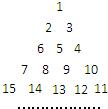

# Mathematics (Grade 4)

**ID**: 60f93a48
**难度**: medium_hard
**题型**: fill_in_the_blank

## 题目
自然数按规律排成了下面的三角形数阵，2001是第$\underline{\hspace{5em}}$行的左起第$\underline{\hspace{5em}}$个数．

## 解答

**答案**: 63, 7

1. Step1:设2001是第n行，根据等差数列求和公式，前n行数字的总数为1 + 2 + 3 + … + n，令其等于接近2001的数
2. Step2:当n = 62时，由等差数列求和公式(首项加末项乘以项数除以2)可得和为(1 + 62)×62÷2 = 1953；当n = 63时，和为(1 + 63)×63÷2 = 2016
3. Step3:由此可知第62行中最大的数是1953，第63行中最大的数是2016，所以2001在第63行
4. Step4:因为奇数行数字是从大到小排列，所以第63行左边是2016，右边是1954
5. Step5:计算2001为第63行左起第2016 - 2001 + 1 = 16个

## 知识点

**知识点**:
  - 数与形结合的规律．

---
