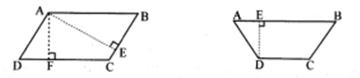

# Mathematics (Grade 4)

**ID**: 814078ba
**难度**: medium_hard
**题型**: fill_in_the_blank

## 题目
找出下列各图中的底和高．

（1）以$\underline{\hspace{5em}}$为底，$\underline{\hspace{5em}}$是高．
（2）以AB为底，$\underline{\hspace{5em}}$是高．

## 解答

**答案**: DC, AF, DE

1. Step1:根据平行四边形高的含义，在第一个图中，DC 边上的点 A 到 DC 的垂线段 AF 为高，所以以 DC 为底，AF 是高
2. Step2:根据梯形高的含义，在第二个图中，AB 边上的点 D 到 AB 的垂线段 DE 为高，所以以 AB 为底，DE 是高

## 知识点

**知识点**:
  - 平行四边形的特征及性质；梯形的特征及分类．

---
