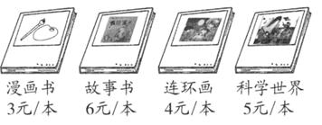

# Mathematics (Grade 4)

**ID**: acc0d778
**难度**: medium_hard
**题型**: fill_in_the_blank

## 题目
我带了27元钱，想要买一种书。

$\begin{array}{|c|c|}
\hline
漫画书
 & 最多可以买（\underline{\hspace{5em}}）本
 \\\hline
故事书
 & 最多可以买（\underline{\hspace{5em}}）本
 \\\hline
连环画
 & 最多可以买（\underline{\hspace{5em}}）本
 \\\hline
科学世界
 & 最多可以买（\underline{\hspace{5em}}）本
 \\\hline
\end{array}$

## 解答

**答案**: 9, 4, 6, 5

1. Step1:已知带了27元，漫画书3元/本，根据数量 = 总价÷单价，可得买漫画书数量为27÷3 = 9本
2. Step2:故事书6元/本，同理可得买故事书数量为27÷6 = 4本余3元，所以最多买4本
3. Step3:连环画4元/本，可得买连环画数量为27÷4 = 6本余3元，所以最多买6本
4. Step4:科学世界5元/本，可得买科学世界数量为27÷5 = 5本余2元，所以最多买5本

## 知识点

**知识点**:
  - 小学数学;数与代数;数的运算;整数的四则运算;有余数的除法;应用题;简单应用题;整数简单应用题

---
