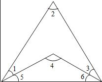

# Mathematics (Grade 4)

**ID**: b49f97e3
**难度**: medium_hard
**题型**: fill_in_the_blank

## 题目
如图中，∠1=21°，∠2=64°，∠3=35°，∠4=______．

## 解答

**答案**: 120°

1. Step1:根据三角形内角和为180°，先计算∠1+∠2+∠3的值，即21°+64°+35°=120°
2. Step2:根据三角形内角和为180°，计算∠5+∠6的值，即180°-(∠1+∠2+∠3)=180°-120°=60°
3. Step3:根据三角形内角和为180°，计算∠4的值，即180°-(∠5+∠6)=180°-60°=120°

## 知识点

**知识点**:
  - 三角形的内角和;角的度量．

---
