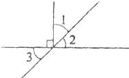

# Mathematics (Grade 4)

**ID**: bcf2032d
**难度**: medium_hard
**题型**: fill_in_the_blank

## 题目
如图，已知∠1=50°，∠2=$\underline{\hspace{5em}}$，∠3=$\underline{\hspace{5em}}$．

## 解答

**答案**: 40°, 40°

1. Step1:根据图可知∠1和∠2组成直角，直角为90°，所以∠2 = 90° - ∠1
2. Step2:已知∠1 = 50°，将其代入∠2 = 90° - ∠1，可得∠2 = 90° - 50° = 40°
3. Step3:由图可知∠1、直角和∠3组成平角，平角是180°，所以∠3 = 180° - 90° - ∠1
4. Step4:把∠1 = 50°代入∠3 = 180° - 90° - ∠1，得出∠3 = 180° - 90° - 50° = 40°

## 知识点

**知识点**:
  - 角的度量．

---
