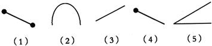

# Mathematics (Grade 4)

**ID**: bdff0bf1
**难度**: medium_hard
**题型**: fill_in_the_blank

## 题目
将序号填在相应的横线上

$\underline{\hspace{5em}}$是线段，$\underline{\hspace{5em}}$是射线，$\underline{\hspace{5em}}$是直线．

## 解答

**答案**: （1）, （4）, （3）

1. Step1:根据线段有2个端点，有限长，可以度量的特点，判断出（1）是线段
2. Step2:依据射线有一个端点，无限长的性质，确定（4）是射线
3. Step3:按照直线无端点，无限长的定义，得出（3）是直线

## 知识点

**知识点**:
  - 直线、线段和射线的认识．

---
