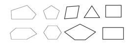

# Mathematics (Grade 4)

**ID**: cea21169
**难度**: medium_hard
**题型**: fill_in_the_blank

## 题目
数一数，填一填。

$\begin{array}{|c|c|c|c|}
\hline
三\ 角形
 & 四边形
 & 五边形
 & 六边形
 \\\hline
（\underline{\hspace{5em}}）个
 & （\underline{\hspace{5em}}）个
 & （\underline{\hspace{5em}}）个
 & （\underline{\hspace{5em}}）个
 \\\hline
\end{array}$

## 解答

**答案**: 1, 3, 3, 2

1. Step1:观察图形，找到三角形，数出其数量为1个
2. Step2:观察图形，找到四边形，数出其数量为3个
3. Step3:观察图形，找到五边形，数出其数量为3个
4. Step4:观察图形，找到六边形，数出其数量为2个

## 知识点

**知识点**:
  - 小学数学;图形与几何;平面图形;平面图形的认识及分类

---
