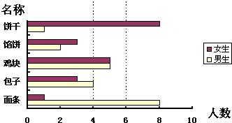

# Mathematics (Grade 4)

**ID**: d0458959
**难度**: medium_hard
**题型**: fill_in_the_blank

## 题目
看图回答问题：如图是五年（1）班同学喜欢的午餐统计图

（1）男生最喜欢的午餐是$\underline{\hspace{5em}}$，女生最喜欢的午餐是$\underline{\hspace{5em}}$．
（2）女生最不喜欢的午餐是$\underline{\hspace{5em}}$，只有$\underline{\hspace{5em}}$人爱吃．

## 解答

**答案**: 面条, 饼干, 面条, 1

1. Step1:观察统计图，找出代表男生的条形图中最长的，其对应的午餐是面条，所以男生最喜欢的午餐是面条
2. Step2:观察统计图，找出代表女生的条形图中最长的，其对应的午餐是饼干，所以女生最喜欢的午餐是饼干
3. Step3:观察统计图，找出代表女生的条形图中最短的，其对应的午餐是面条，所以女生最不喜欢的午餐是面条
4. Step4:查看女生喜欢面条对应的人数，为1人

## 知识点

**知识点**:
  - 两种不同形式的复式条形统计图；从统计图表中获取信息．

---
