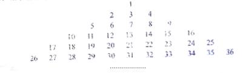

# Mathematics (Grade 4)

**ID**: deb70aa8
**难度**: medium_hard
**题型**: fill_in_the_blank

## 题目
如下数表是由从1开始的连续自然数组成，观察规律并完成各题的解答．

（1）表中第9行的最后一个数是$\underline{\hspace{5em}}$；
（2）第9行共有$\underline{\hspace{5em}}$个数．

## 解答

**答案**: 81, 17

1. Step1:观察数表，发现规律，第n行的最后一个数是n²，对于第（1）问，求第9行的最后一个数，将n = 9代入规律，即9² = 81
2. Step2:观察数表规律，得出第n行共2n - 1个数，对于第（2）问，求第9行的数的个数，将n = 9代入规律，即2×9 - 1 = 17

## 知识点

**知识点**:
  - 数与形结合的规律．

---
