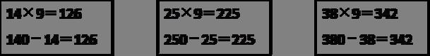

# Mathematics (Grade 4)

**ID**: e2bcb39d
**难度**: medium_hard
**题型**: fill_in_the_blank

## 题目
观察下面每组算式：

（1）找出规律后填一填。
46×9＝460－（________）＝（_________）
67×9＝（_____）－（_____）＝（_______）
（2）请再写出一组有这种规律的算式。
（_____）×9＝（_____）－（_____）＝（______）

## 解答

**答案**: 46, 414, 670, 67, 603, 87, 870, 87, 783

1. Step1:观察给出的示例算式，发现规律为一个数乘以9等于这个数扩大10倍后减去这个数本身
2. Step2:对于46×9，根据规律，等于460 - 46，计算460 - 46 = 414
3. Step3:对于67×9，根据规律，等于670 - 67，计算670 - 67 = 603
4. Step4:按照规律写出一组新算式，例如87×9 = 870 - 87，计算870 - 87 = 783

## 知识点

**知识点**:
  - 小学数学;数与代数;数的运算;整数的四则运算;整数乘法

---
