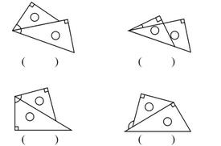

# Mathematics (Grade 4)

**ID**: e9d7bcbb
**难度**: medium_hard
**题型**: fill_in_the_blank

## 题目
下面用三角尺拼成的角各是多少度？填一填。

## 解答

**答案**: 75°, 15°, 105°, 135°

1. Step1:对于第一个图，根据题意是把三角板的45°角和30°角的顶点重合拼出的角，计算其度数为45°+30°=75°
2. Step2:对于第二个图，是把三角板的45°角和30°角的顶点重合，角的一条边重合拼出的角，计算其度数为45°-30°=15°
3. Step3:对于第三个图，是把三角板的45°角和60°角的顶点重合拼出的角，计算其度数为45°+60°=105°
4. Step4:对于第四个图，是三角板45°角与三角板的一条边拼成平角，计算其度数为180°-45°=135°

## 知识点

**知识点**:
  - 角的度量

---
