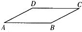

# Mathematics (Grade 4)

**ID**: f0aab648
**难度**: medium_hard
**题型**: fill_in_the_blank

## 题目
如图，平行四边形中，∠A=30°，则∠B=$\underline{\hspace{5em}}$，∠C=$\underline{\hspace{5em}}$，∠D=$\underline{\hspace{5em}}$

## 解答

**答案**: 150°, 30°, 150°

1. Step1:根据平行四边形的性质，平行四边形的对角相等，已知∠A = 30°，所以∠C = ∠A = 30°
2. Step2:根据平行四边形的性质，平行四边形的邻角互补，∠A与∠D是邻角，所以∠A + ∠D = 180°，又因为∠A = 30°，则∠D = 180° - 30° = 150°
3. Step3:根据平行四边形的性质，平行四边形的对角相等，∠B与∠D是对角，所以∠B = ∠D = 150°

## 知识点

**知识点**:
  - 平行四边形的特征及性质．

---
