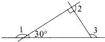

# Mathematics (Grade 4)

**ID**: fdd7ce44
**难度**: medium_hard
**题型**: fill_in_the_blank

## 题目
求出下面各角的度数． 
∠1=
∠2=
∠3=

## 解答

**答案**: 150, 90, 120

1. Step1:因为平角为180°，由图可知∠1与30°角组成平角，所以∠1 = 180° - 30° = 150°
2. Step2:由图可知∠2所在的角为平角，且直角为90°，所以∠2 = 180° - 90° = 90°
3. Step3:先根据三角形内角和为180°，算出与∠3相邻的三角形内角为180° - 90° - 30° = 60°，又因为∠3与该角组成平角，所以∠3 = 180° - 60° = 120°

## 知识点

**知识点**:
  - 角的度量．

---
