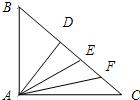

# Mathematics (Grade 4)

**ID**: 04cc6e19
**难度**: medium_hard
**题型**: multiple_choice

## 题目
从A点到BC所作的垂线段是（  ）

$\begin{description}
\item A．AB\item B．AD\item C．AE\item D．AF\item E．AC
\end{description}$

## 解答

**答案**: B

1. Step1:明确从一点到一条直线所作垂线段的定义，即该点到直线的垂直线段，垂线段与直线所成夹角为90度。
2. Step2:根据解析2，分别用量角器测量AD，AE，AF与BC所成的夹角。
3. Step3:根据解析1，测量得到∠ADB=90°，即AD与BC所成夹角为90度，满足垂线段条件。
4. Step4:得出从A点到BC所作的垂线段是AD，答案选B。

## 知识点

**知识点**:
  - 垂直与平行的特征及性质．

---
