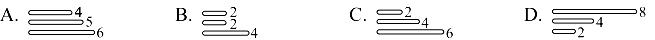

# Mathematics (Grade 4)

**ID**: 13574c72
**难度**: medium_hard
**题型**: multiple_choice

## 题目
在学习三角形特征时，4名同学分别选取了3根小棒，可以围成三角形的是（）。

## 解答

**答案**: A

1. Step1:明确三角形三边关系为两边之和大于第三边，两边之差小于第三边
2. Step2:分析选项A，计算4+5=9＞6，6-4=2＜5，满足三边关系
3. Step3:分析选项B，计算2+2=4，不满足两边之和大于第三边
4. Step4:分析选项C，计算2+4=6，不满足两边之和大于第三边
5. Step5:分析选项D，计算2+4=6＜8，不满足两边之和大于第三边
6. Step6:综上，只有选项A满足三边关系，能围成三角形，所以答案是A

## 知识点

**知识点**:
  - 三角形边的关系

---
