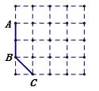

# Mathematics (Grade 4)

**ID**: 2d3e8aee
**难度**: medium_hard
**题型**: multiple_choice

## 题目
在给定的正方形点子图上，找一点$\textit{D}$（$\textit{D}$在格点上），使四边形$\textit{ABCD}$是一个梯形．那么符合条件的$\textit{D}$点的位置有（    ）．

A．3个
B．4个
C．5个
D．6个

## 解答

**答案**: C

1. Step1:明确梯形的定义为一组对边平行而另一组对边不平行的四边形。
2. Step2:在给定的正方形点子图上，分别考虑以AB、BC、AC为一边构造梯形的情况。
3. Step3:当以AB为底边时，可找到2个符合条件的D点使AD平行于BC构成梯形。
4. Step4:当以BC为底边时，可找到2个符合条件的D点使CD平行于AB构成梯形。
5. Step5:当以AC为底边时，可找到1个符合条件的D点使AD平行于BC构成梯形。
6. Step6:将所有符合条件的D点个数相加，2 + 2 + 1 = 5个。

## 知识点

**知识点**:
  - 

---
