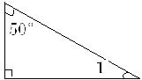

# Mathematics (Grade 4)

**ID**: 3151718e
**难度**: medium_hard
**题型**: multiple_choice

## 题目
如图，在一个直角三角形中，∠1=（  ） 

A．30
B．40
C．不能确定

## 解答

**答案**: B

1. Step1:明确三角形内角和是180°
2. Step2:因为是直角三角形，所以其中一个角是90°
3. Step3:已知另一个角是50°
4. Step4:根据三角形内角和，求∠1的度数，即∠1 = 180 - 90 - 50
5. Step5:计算180 - 90 - 50 = 90 - 50 = 40（度）
6. Step6:得出∠1等于40度，对应选项B

## 知识点

**知识点**:
  - 三角形的内角和．

---
