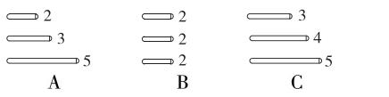

# Mathematics (Grade 4)

**ID**: 3caddfa7
**难度**: medium_hard
**题型**: multiple_choice

## 题目
下面（）组中的三根小棒不能拼成一个三角形。（单位：厘米）

## 解答

**答案**: A

1. Step1:明确三角形三边关系为任意两边之和大于第三边，任意两边之差小于第三边
2. Step2:分析选项A，计算2厘米与3厘米的和为5厘米，等于第三边5厘米，不满足任意两边之和大于第三边，所以不能拼成三角形
3. Step3:分析选项B，计算2厘米与2厘米的和为4厘米，大于第三边2厘米，满足三边关系，能拼成三角形
4. Step4:分析选项C，计算3厘米与4厘米的和为7厘米，大于第三边5厘米，满足三边关系，能拼成三角形
5. Step5:综上，不能拼成三角形的是选项A

## 知识点

**知识点**:
  - 三角形边的关系

---
