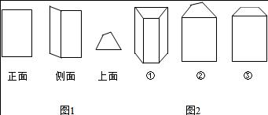

# Mathematics (Grade 4)

**ID**: 6834d470
**难度**: medium_hard
**题型**: multiple_choice

## 题目
桌面上放着三个不同的物体，小明从不同的角度看其中的一个物体，看到的图形如图．那么，他看到的物体是图2中的（  ）

$\begin{description}
\item A．①\item B．②\item C．③
\end{description}$

## 解答

**答案**: B

1. Step1:从正面看得到的图形是一个长方形，而图形①从正面看不是长方形，所以排除图形①
2. Step2:从上面看得到的图形是一个不规则梯形，而图形③从上面看不是不规则梯形，所以排除图形③
3. Step3:排除①和③后，可知小明看到的物体是图2中的②，答案选B

## 知识点

**知识点**:
  - 从不同方向观察物体和几何体．

---
