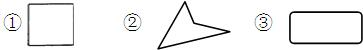

# Mathematics (Grade 4)

**ID**: 72b6e561
**难度**: medium_hard
**题型**: multiple_choice

## 题目
下面三个图形中，（  ）不是四边形．

$\begin{description}
\item A．①\item B．②\item C．③
\end{description}$

## 解答

**答案**: C

1. Step1:明确四边形的定义为在同一平面内，由不在同一直线上四条线段依次首尾相接围成的封闭的图形。
2. Step2:观察图形①，其是由四条线段依次首尾相接围成的封闭图形，是四边形。
3. Step3:观察图形②，其是由四条线段依次首尾相接围成的封闭图形，是四边形。
4. Step4:观察图形③，其不是由四条线段依次首尾相接围成的封闭图形，不是四边形。
5. Step5:得出答案为图形③，对应选项C。

## 知识点

**知识点**:
  - 四边形的特点、分类及识别．

---
