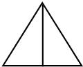

# Mathematics (Grade 4)

**ID**: 74dd45b7
**难度**: medium_hard
**题型**: multiple_choice

## 题目
如图把一个等腰三角形从它的一个顶点平均分成2个三角形，每个小三角形的内角和是(  )
A．90°
B．180°
C．360°

## 解答

**答案**: B

1. Step1:明确问题是求把等腰三角形从一个顶点平均分成2个三角形后每个小三角形的内角和
2. Step2:依据三角形内角和的性质，即无论三角形的形状、大小如何，其内角和固定为180度
3. Step3:得出每个小三角形内角和是180度，所以答案选B

## 知识点

**知识点**:
  - 三角形的内角和．

---
