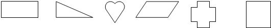

# Mathematics (Grade 4)

**ID**: 80341634
**难度**: medium_hard
**题型**: multiple_choice

## 题目
下面的图形中，有(  )个轴对称图形．

A．4
B．5
C．6

## 解答

**答案**: A

1. Step1:明确轴对称图形的定义，即一个图形沿一条直线折叠后直线两旁的部分能够完全重合，这条直线就是这个轴对称图形的对称轴，且对称点到对称轴的距离相等。
2. Step2:观察第一个图形长方形，沿其长或宽的中垂线折叠，直线两旁的部分能够完全重合，所以它是轴对称图形。
3. Step3:观察第二个图形三角形，无论沿哪条直线折叠，直线两旁的部分都不能完全重合，所以它不是轴对称图形。
4. Step4:观察第三个图形心形，沿其纵向的一条直线折叠，直线两旁的部分能够完全重合，所以它是轴对称图形。
5. Step5:观察第四个图形平行四边形，无论沿哪条直线折叠，直线两旁的部分都不能完全重合，所以它不是轴对称图形。
6. Step6:观察第五个图形十字形，沿横竖两条直线折叠，直线两旁的部分都能够完全重合，所以它是轴对称图形。
7. Step7:观察第六个图形正方形，沿其对边中点连线或对角线折叠，直线两旁的部分都能够完全重合，所以它是轴对称图形。
8. Step8:统计轴对称图形的个数，长方形、心形、十字形、正方形是轴对称图形，共4个。

## 知识点

**知识点**:
  - 轴对称图形的辨识．

---
