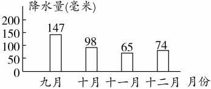

# Mathematics (Grade 4)

**ID**: 8fbc8711
**难度**: medium_hard
**题型**: multiple_choice

## 题目
某地去年最后四个月的降水量如图，该地这四个月的平均降水量是（）毫米。

A.147
B.98
C.96
D.86

## 解答

**答案**: C

1. Step1:从条形统计图中获取九月降水量为147毫米
2. Step2:从条形统计图中获取十月降水量为98毫米
3. Step3:从条形统计图中获取十一月降水量为65毫米
4. Step4:从条形统计图中获取十二月降水量为74毫米
5. Step5:计算四个月降水总量，147+98+65+74=384毫米
6. Step6:计算平均降水量，384÷4=96毫米
7. Step7:得出答案为96毫米，对应选项C

## 知识点

**知识点**:
  - 平均数、中位数、众数的意义及求法

---
