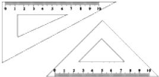

# Mathematics (Grade 4)

**ID**: 8fde8b61
**难度**: medium_hard
**题型**: multiple_choice

## 题目
下面的角度中不能用一副三角板画成的是（  ）
$\begin{description}
\item A．15°\item B．80°\item C．105°\item D．180°
\end{description}$

## 解答

**答案**: B

1. Step1:明确一副三角板中含有的角，分别为30°、45°、60°、90°
2. Step2:分析选项A，15°=60° - 45°，所以15°角能用一副三角板画成
3. Step3:分析选项B，80°不能通过30°、45°、60°、90°这些角进行组合得到，所以80°不能用一副三角板画成
4. Step4:分析选项C，105°=60° + 45°，所以105°角能用一副三角板画成
5. Step5:分析选项D，180°=90° + 90°，所以180°角能用一副三角板画成
6. Step6:综上，不能用一副三角板画成的角是80°，答案选B

## 知识点

**知识点**:
  - 角的度量．

---
