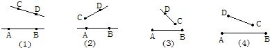

# Mathematics (Grade 4)

**ID**: 969e00bb
**难度**: medium_hard
**题型**: multiple_choice

## 题目
下列五5图中的线段（或直线、射线）能相交的是（  ）

$\begin{description}
\item A．（1）\item B．（2）\item C．（3）\item D．（4）
\end{description}$

## 解答

**答案**: A

1. Step1:明确直线可向两端无限延伸，射线可向一端无限延伸，线段不能延伸
2. Step2:分析（1），两条都是直线，延伸后会相交
3. Step3:分析（2），一条射线向D端延长，一条直线，二者不会相交
4. Step4:分析（3），一条射线向D端无限延伸，一条线段，延长射线后不会相交
5. Step5:分析（4），两条都是线段，不能延伸，不会相交
6. Step6:得出能相交的是（1），答案为A

## 知识点

**知识点**:
  - 直线、线段和射线的认识．

---
