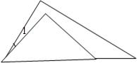

# Mathematics (Grade 4)

**ID**: 9ceca382
**难度**: medium_hard
**题型**: multiple_choice

## 题目
如图，∠1等于（  ）度．

A．15°
B．45°
C．60°

## 解答

**答案**: A

1. Step1:观察图形，确定∠1是由两个直角三角板的内角组成
2. Step2:找出组成∠1的两个内角分别是60°和45°
3. Step3:计算∠1的度数，即∠1 = 60° - 45° = 15°
4. Step4:根据计算结果，在选项中选择A

## 知识点

**知识点**:
  - 角的度量．

---
