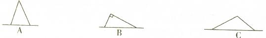

# Mathematics (Grade 4)

**ID**: a34f3af2
**难度**: medium_hard
**题型**: multiple_choice

## 题目
下面各三角形被纸遮住了一部分，（）不能确定是什么三角形。

## 解答

**答案**: A

1. Step1:分析图A，露出的角是锐角，由于三角形内角和为180度，仅知道一个锐角，无法确定遮住的两个角中有没有直角或钝角，所以不能确定图A是什么三角形
2. Step2:分析图B，露出的角是直角，根据直角三角形的定义，有一个角是直角的三角形是直角三角形，所以图B是直角三角形
3. Step3:分析图C，露出的角是钝角，根据钝角三角形的定义，有一个角是钝角的三角形是钝角三角形，所以图C是钝角三角形
4. Step4:综合以上分析，只有图A不能确定是什么三角形，答案为A

## 知识点

**知识点**:
  - 三角形的分类

---
