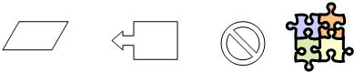

# Mathematics (Grade 4)

**ID**: ade08b23
**难度**: medium_hard
**题型**: multiple_choice

## 题目
下列图形中，轴对称图形有（  ）个．

$\begin{description}
\item A．1\item B．2\item C．3\item D．4
\end{description}$

## 解答

**答案**: B

1. Step1:明确轴对称图形的定义为如果一个图形沿着一条直线对折后两部分完全重合，这样的图形叫做轴对称图形，这条直线叫做对称轴
2. Step2:观察从左数第一个图形平行四边形，无论沿哪条直线对折，直线两侧的部分都不能完全重合，所以它不是轴对称图形
3. Step3:观察从左数第二个图形，能找到一条直线，使其沿这条直线对折后两部分完全重合，所以它是轴对称图形
4. Step4:观察从左数第三个图形，能找到一条直线，使其沿这条直线对折后两部分完全重合，所以它是轴对称图形
5. Step5:观察从左数第四个图形拼图，无论沿哪条直线对折，直线两侧的部分都不能完全重合，所以它不是轴对称图形
6. Step6:统计轴对称图形的个数为2个

## 知识点

**知识点**:
  - 轴对称图形的辨识．

---
