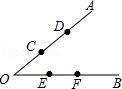

# Mathematics (Grade 4)

**ID**: c3e320e2
**难度**: medium_hard
**题型**: multiple_choice

## 题目
已知，如图，C、D是OA上两点，E、F是OB上两点，下列各式中，表示∠AOB错误的是（ ）

$\begin{description}
\item A．∠COE\item B．∠AOF\item C．∠DOB\item D．∠EOF
\end{description}$

## 解答

**答案**: D

1. Step1:明确角的定义为有公共端点的两条射线组成的图形
2. Step2:分析选项A，∠COE的两条边分别落在射线OA和射线OB上，能表示∠AOB
3. Step3:分析选项B，∠AOF的两条边分别落在射线OA和射线OB上，能表示∠AOB
4. Step4:分析选项C，∠DOB的两条边分别落在射线OA和射线OB上，能表示∠AOB
5. Step5:分析选项D，∠EOF的两条边均落在射线OB上，不能表示∠AOB

## 知识点

**知识点**:
  - 

---
