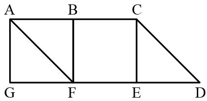

# Mathematics (Grade 4)

**ID**: d54b7f20
**难度**: medium_hard
**题型**: multiple_choice

## 题目
下图中有（    ）个梯形。 

A.2
B.3
C.4
D.5

## 解答

**答案**: B

1. Step1:明确梯形的定义为只有一组对边平行的四边形
2. Step2:在图中找出梯形BCDF
3. Step3:在图中找出梯形EFAC
4. Step4:在图中找出梯形ACDG
5. Step5:统计梯形的个数为3个
6. Step6:根据选项，答案为B

## 知识点

**知识点**:
  - 

---
