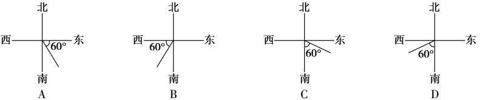

# Mathematics (Grade 4)

**ID**: e0cd9412
**难度**: medium_hard
**题型**: multiple_choice

## 题目
下列图形中表示南偏西60°的射线是（ ）

## 解答

**答案**: D

1. Step1:明确方向角规则，按上北下南、左西右东的原则，方向角通常以正北或正南方向为角的始边，以对象所处的射线为终边
2. Step2:分析南偏西60°的含义，即南方向线与对象所处的射线的夹角为60°
3. Step3:观察A选项，其射线与南方向线夹角不符合南偏西60°
4. Step4:观察B选项，其射线与南方向线夹角不符合南偏西60°
5. Step5:观察C选项，其射线与南方向线夹角不符合南偏西60°
6. Step6:观察D选项，其射线与南方向线夹角为60°，符合南偏西60°，所以答案是D

## 知识点

**知识点**:
  - 方位角;角的定义及其表示方法

---
