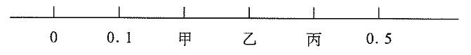

# Mathematics (Grade 4)

**ID**: e8314b48
**难度**: medium_hard
**题型**: multiple_choice

## 题目
下面的数线上每一点代表一个数，0.38应该在（    ）

 A.甲、乙之间
 B.乙、丙之B间
 C.丙右边
 D.甲左边

## 解答

**答案**: B

1. Step1:明确数线上每个大格代表0.1
2. Step2:确定甲代表的数是0.2
3. Step3:确定乙代表的数是0.3
4. Step4:确定丙代表的数是0.4
5. Step5:判断0.38大于0.3且小于0.4
6. Step6:得出0.38在乙、丙之间，所以答案选B

## 知识点

**知识点**:
  - 小数的意义和加减法

---
