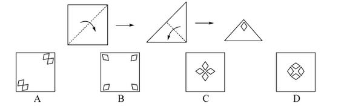

# Mathematics (Grade 4)

**ID**: f13d01f1
**难度**: medium_hard
**题型**: multiple_choice

## 题目
如下图所示，将一张正方形纸沿对角线对折两次后，剪下一个平行四边形，则展开后得到的图形是（）

## 解答

**答案**: C

1. Step1:明确题目要求是将一张正方形纸沿对角线对折两次后剪下一个平行四边形，判断展开后得到的图形
2. Step2:根据折叠知识可知，对折两次后剪下的平行四边形位置是聚集在一起的
3. Step3:通过动手操作的方式，找一张纸按照图中的方法实际操作
4. Step4:得出实际操作后展开得到的图形是C

## 知识点

**知识点**:
  - 轴对称

---
