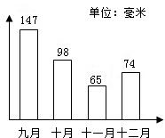

# Mathematics (Grade 4)

**ID**: f6a3257f
**难度**: medium_hard
**题型**: multiple_choice

## 题目
某地去年最后四个月的降水量如图，这个地方在这四个月里每月平均降水量（  ）毫米．
$\begin{description}
\item A．147\item B．98\item C．96\item D．86
\end{description}$

## 解答

**答案**: C

1. Step1:明确需要求四个月的平均降水量，根据求平均数的方法，要用四个月降水量的总量除以总份数（4个月）
2. Step2:从统计图中获取九月降水量为147毫米，十月降水量为98毫米，十一月降水量为65毫米，十二月降水量为74毫米
3. Step3:计算四个月降水量的总量，即147 + 98 + 65 + 74 = 384毫米
4. Step4:用总量384毫米除以总份数4，得到384÷4 = 96毫米

## 知识点

**知识点**:
  - 两种不同形式的单式条形统计图；平均数的含义及求平均数的方法．

---
